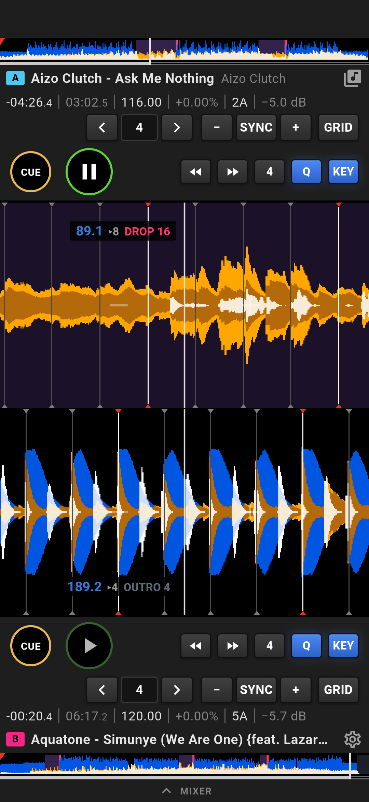
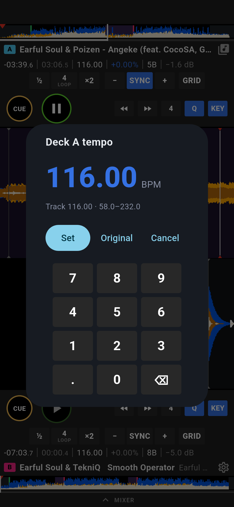
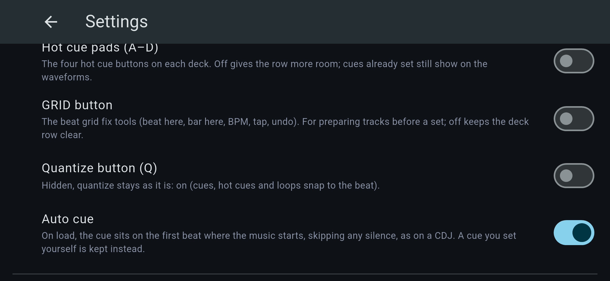
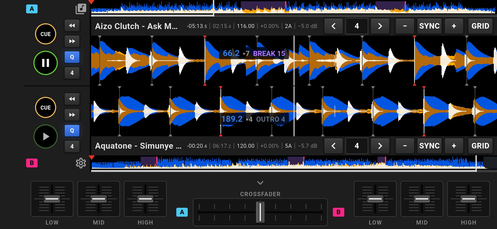
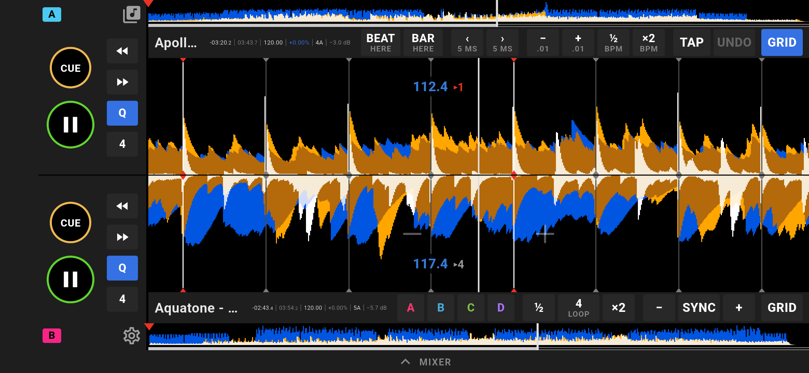
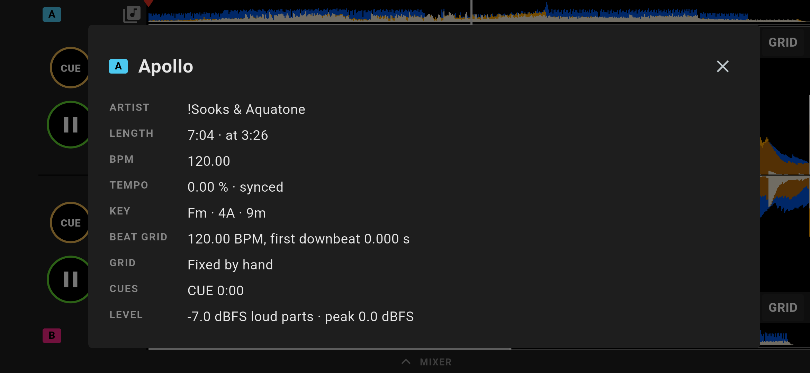
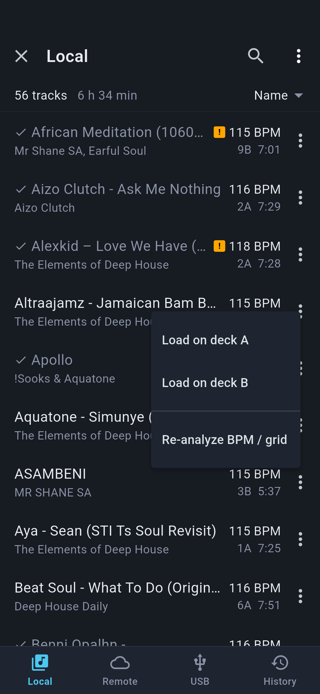
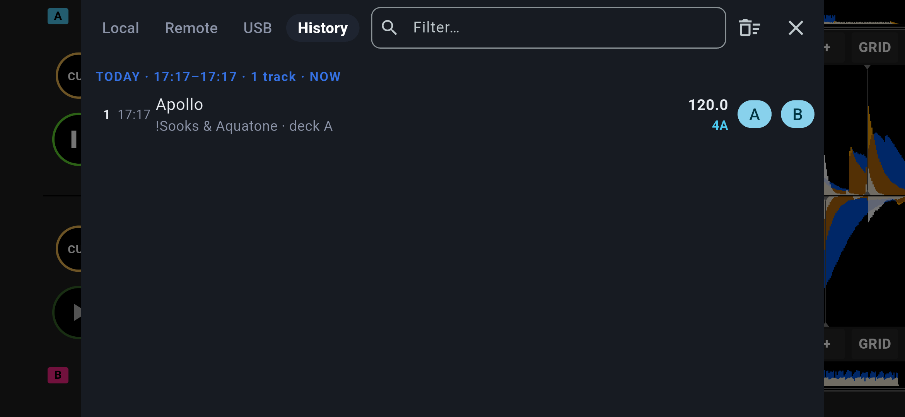
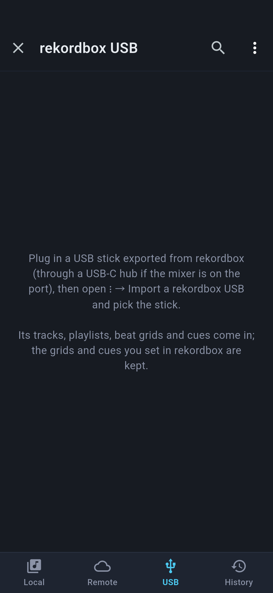

<p align="center">
  
</p>
<h2 align="center"><b>SideDeck</b></h2>
<h4 align="center">Free DJ app for Android and iPhone. Mix on your phone, or on hardware.</h4>

<div align="center">
  <table align="center">
    <tr>
      <td align="center" valign="middle">
        <a href="https://f-droid.org/packages/es.manifold.sidedeck"></a>
      </td>
      <td align="center" valign="middle">
        <a href="https://play.google.com/store/apps/details?id=es.manifold.sidedeck"></a>
      </td>
      <td align="center" valign="middle">
        <a href="https://apps.apple.com/app/id6827595789"></a>
      </td>
    </tr>
  </table>
</div>

Android and iPhone DJ deck for local files and a Subsonic music server.
Landscape dual decks, 3-band waveforms, and an internal mixer, or four-channel
USB out to an external mixer such as the Teenage Engineering EP-136 K.O. Sidekick.

> **This is a fork** of [manueljpy/SideDeck](https://github.com/manueljpy/SideDeck).
> The store badges above install the upstream app, which does not include the
> changes listed under [What this fork adds](#what-this-fork-adds). Build from
> this branch to get them.


 









   

## What this fork adds

| Area | Change |
|---|---|
| External mixer | Fixed silent playback on Samsung/Qualcomm phones; decks take the full screen in external mode |
| Waveforms | rbxport-style 3-band waveforms, mirrored at a shared centre line; pinch zoom; smooth motion |
| Deck controls | New control row and two-column transport rail, CUE, hot cues A–D, quantize, beat jump, on-wave nudge; tap the title for track details |
| Navigation | Drag the waveform to scrub; bar / phrase counter; track sections (intro, break, drop, outro) with a countdown |
| Screen | Upright layout as well as landscape (auto, or locked either way); optional full (mirrored) waveforms |
| Mixer | Restyled faders with a centre notch and blue offset fill; double-tap resets; filter fader optional; hide it to give the decks the screen |
| Auto gain | Every track levelled to the same loudness without clipping |
| Tempo | Key lock switch; optional tempo fader per deck (±8 / ±16 / ±50 %) |
| Sync | Beat sync: SYNC matches tempo *and* snaps into beat phase; tap again to release; long-press to type an exact BPM |
| Cues | Cue and hot cues saved per track and restored on load; Auto Cue parks new tracks on their first beat; hot cue pads can be hidden |
| Beat grid | Whole-track analysis, kick-attack grid fit, checked BPM rounding, drift correction, "check grid" warning, hand-fixed grids protected; grid fix tools (beat here, bar here, BPM edit, tap tempo, undo) |
| Library | Clean layout: top bar with search and a ⋮ tools menu, count / total time / sort line, rows with a ⋮ load menu, tabs along the bottom; key display setting; played marks and a History tab with time played; rekordbox USB import (untested on a real stick) |

Details of each are below.

### External mixer (USB) fix

On some Samsung / Qualcomm phones (found on a Galaxy S26, Android 17, with the
EP-136) external mixer mode turned on but played nothing, and the playhead ran
through the whole track in about a second. The 4-channel track, built in exactly
the mixer format, was matched to a `direct_pcm` output that failed to start
(`AudioTrack: start(): status -32`) after ~10 s of retries; `play()` swallowed
the error and the write loop spun.

- The USB track is now built as float with a channel index mask, which only fits
  the reconfigured mixer thread; the exact mixer format is the fallback.
- A track is only accepted once its playback head actually moves after `play()`.
- The write loop never renders ahead of what the track consumed, and stops
  (instead of spinning) if the output stops taking audio.

Upstream: [issue #13](https://github.com/manueljpy/SideDeck/issues/13),
[PR #14](https://github.com/manueljpy/SideDeck/pull/14).

### Waveforms (after rbxport)

- **3-band colouring:** each column carries low (< 300 Hz), mid (250 Hz–1.2 kHz)
  and high (3–9 kHz) energy, computed in the engine's track scan with
  rekordbox-style envelopes and a per-track gain. Blue = bass / kicks,
  amber = mids / vocals / synths, white = highs / hats; overlaps blend.
- **Mirrored decks:** deck A's detail rises to the line between the decks and
  deck B's hangs from it, so the two beat grids can be compared at a glance.
- **Overview** of the whole track per deck, stacked from its baseline, with a
  played-position bar.
- **Beat grid:** grey beats, white downbeats, triangle heads (red on downbeats).
- **Pinch to zoom** (1.5–32 s across the screen, shared by both decks so their
  grids stay comparable); double-tap resets to 4 s. Far out, only bar lines draw.
- **Smooth motion:** the playhead is animated every frame between engine updates
  instead of hopping 20 times a second.

### Deck controls

- **Control row** between each overview and detail: title and artist, then
  `-MM:SS.t` remaining, `MM:SS.t` elapsed, BPM (0.01), tempo %, key; hot cue pads;
  `‹ 4 ›` (the loop length in a recessed readout between halve and double);
  `− · SYNC · +`; `GRID`. Buttons are raised and lit from above, and glow blue
  when on; set hot cues shade in their slot colour.
- **Transport rail,** in two columns: CUE over PLAY, and beside them beat-jump
  ◀◀ ▶▶, **Q** (quantize) and the jump size; small A/B tags; library (deck A)
  and settings (deck B). A gap at the centre line keeps deck B's CUE clear of
  deck A.
- **Track details:** tap a deck's title for artist, album (rekordbox), length
  and position, playing and original BPM, tempo and sync, key in musical /
  Camelot / Open Key, the beat grid and its state, cue and hot cue times,
  loudness and auto gain, format, size, source and file path. It updates live
  and the text can be copied.
- **On-wave nudge:** faint − / + either side of the playhead. Hold while playing
  to bend tempo ±8 %; tap or hold while paused to jog 40 ms.
- **Bar / phrase counter** beside the playhead, e.g. `33.2 ▸3`: bar 33, beat 2,
  three bars to the next 8-bar phrase (red on the last bar). Bar 1 is the grid's
  first beat.
- **Track sections** (Settings → Waveform, on by default): INTRO, MAIN, BREAK,
  DROP and OUTRO, found from where the low end (kick and bass) drops out and
  comes back, bar by bar on the beat grid. Fills and kick drops under 4 bars
  don't count, and changes land on 4-bar lines. Bass-less stretches are tinted
  on the overview and detail, each section start gets a coloured line and tag,
  and the bar counter counts down to the next change within 32 bars
  (`33.2 ▸3  BREAK 7`). They follow the grid, so a grid fix moves them. A break
  that keeps the kick going isn't marked yet.
- **Full waveform** (Settings → Waveform, off by default): both decks' scrolling
  waveforms drawn mirrored round their middle instead of from the centre line.

### Upright (portrait) layout

**Settings → Screen:** Auto (turns with the phone and keeps to its rotation
lock), Landscape or Portrait. Upright, the side rail goes: each deck has its
overview, a title row (library or settings on the right), the readouts, the
control row and a transport row (CUE, PLAY, ◀◀ ▶▶, jump size, Q, KEY), and the
two scrolling waveforms meet in the middle of the screen with the mixer below.
The tempo fader is landscape-only; − / + and the SYNC pad set tempo upright.
The library toolbar and the BPM pad wrap to fit, and the library stays clear of
the camera cutout.

### Cues, hot cues and scrubbing

- **Drag the detail waveform** to move the track under the playhead like a
  record (playing or paused); drag or tap the overview to seek.
- **CUE** works like a CDJ: paused, it sets the cue at the playhead; playing, it
  returns to the cue and pauses; held on the cue point, it previews and snaps
  back on release (press PLAY while holding to keep playing).
- **Hot cues A–D:** tap an empty pad to store the playhead, tap a set pad to jump
  (staying playing or paused), long-press to clear. Badges mark them on the
  waveform and overview.
- **Saved per track:** the cue and hot cues are stored by file path and restored
  on load; a deck with a saved cue opens parked on it.
- **Auto Cue** (Settings → Deck buttons, on by default): a track with no saved
  cue loads parked on the first beat where the music starts, skipping leading
  silence, as on a CDJ. Without a grid it cues the first sound.
- **Hot cue pads** can be hidden (Settings → Deck buttons) to give the control
  row room; set cues still show on the waveforms.
- **Quantize (Q, on by default):** CUE, new hot cues and loop-in snap to the
  nearest beat, and hot cue jumps while playing keep the beat phase.
- **Beat jump:** ◀◀ ▶▶ by 1, 2, 4, 8, 16 or 32 beats (tap the size box to cycle).

### Mixer

Restyled after rbxport's neutral mixer: each fader sits in a recessed well with
tick marks, on a dark rail with a centre notch and a shaded cap, and a blue fill from the centre so any EQ, filter or crossfader move away
from flat is visible. Double-tap a fader to reset it (EQ flat, filter off,
crossfader centred). In external mixer mode the strip is hidden and the decks
use the whole screen.

The filter fader is off by default, so the strip is EQ and crossfader only and
gives the decks a little more height. **Settings → On-screen mixer → Filter**
brings a FILT fader back to each deck (down for low-pass, up for high-pass);
turning it off resets both filters.

The **▼** above the crossfader hides the internal mixer too, so the decks get
the whole screen; a slim **▲ MIXER** strip at the bottom brings it back. EQ,
filter and crossfader keep their settings while hidden, and the choice is
remembered.

### Sync

SYNC matches the synced deck's tempo to the other deck and keeps following it.
With both decks playing it also shifts the synced deck by under half a beat so
the beats line up; a synced deck started under a playing deck snaps into phase
as it starts. It aligns beats, not bars. Tap SYNC again to release it; the
deck keeps the tempo it had.

**Long-press SYNC** to type an exact BPM on an in-app keypad (the phone's
keyboard would cover a landscape screen): Set, Original (the track's own BPM)
or Cancel, anywhere from half to double the track's BPM. It releases sync on
that deck, and a deck synced to it follows.

### Tempo fader and key lock

- **Key lock** (Settings → Tempo, on by default): the pitch stays put when the
  tempo changes. Off, pitch follows tempo like a turntable.
- **Tempo fader** (Settings → Tempo → Tempo fader on the deck rails, off by
  default to keep the rail compact): a third rail column per deck, after the
  CDJ's tempo slider. **KEY** above it sets key lock for that deck; the fader
  is drag-only and relative, so a stray tap never jumps the tempo, clicks into
  0 % on the way through and resets on double-tap; the button below cycles the
  range ±8 / ±16 / ±50 %. Pulling it down speeds up, as on a CDJ (a setting
  flips it). It follows SYNC and − / +, and moving it ends sync. Range and key
  lock are remembered per deck.

### Auto gain

Tracks are levelled to a common loudness, after Mixxx's ReplayGain-based track
gain, so a mix doesn't jump between quiet and hot masters. While the waveform
is scanned, SideDeck measures the loud parts (95th percentile of 50 ms RMS
blocks) and the peak. The deck gain is then trimmed toward -10 dBFS, within
-12 to +6 dB, and a boost never takes the peak above -0.3 dBFS. The applied
change shows after the key on the deck (e.g. `-3.0 dB`). On by default; turn
it off in Settings.

### Beat grid accuracy

Studied from [Mixxx](https://github.com/mixxxdj/mixxx),
[rbxport](https://github.com/chrisle/rbxport) and
[openDJ](https://github.com/openwave-studio/opendj):

- **Whole-track analysis** (up to 15 min) instead of the first 60 s, decoded in
  chunks so memory stays around 4 bytes per sample.
- **Kick-attack fit** (rbxport): each predicted beat is snapped to the kick's
  attack, found to the millisecond in the 900–9000 Hz click band, and a weighted
  line through the hits gives the period and phase. It is only used where it
  clearly locks on (≥ 45 % of beats on an attack, median ≤ 2 ms); soft, round
  kicks keep the low-band grid.
- **Checked rounding:** a whole BPM is kept only if its grid still sits on the
  hits (rbxport's 85 % rule), so a real 127.97 track is not rounded into drift.
- **Drift correction:** for soft kicks the grid's offset is followed through
  the track in 16-bar windows of low-band kick energy; a steady drift corrects
  the BPM, kept only if the grid then holds clearly better.
- **"Check grid" warning:** if the grid does not hold through the track (a
  wrong tempo, a tempo change, or a section stitched in at a different phase),
  the deck's BPM turns amber with a "!" and the library marks the track with a "!".
  A tight kick-attack lock counts as trusted.
- **Hand-fixed grids are protected:** grid edits mark a track, "Re-analyze all"
  skips it, and the analysis cache now migrates in place instead of being wiped
  on upgrades. Re-analyzing a single track still replaces the fix on purpose.

Grids analyzed by an older build keep their old values until re-analyzed
("Re-analyze all" in the library).

### Fixing a grid by hand (GRID mode)

Tap **GRID** on a deck. The wave still scrubs and zooms, so put a kick under
the playhead first:

| Button | What it does |
|---|---|
| BEAT HERE | The beat line nearest the playhead moves onto it |
| BAR HERE | The playhead becomes bar 1, beat 1 |
| ‹ › 5 MS | Shift the whole grid (hold to repeat) |
| − / + .01 | BPM down / up by 0.01 (hold to repeat) |
| ½ / ×2 BPM | Analysis caught half or double the real tempo |
| TAP | Tap along; from the 4th tap the BPM follows your average |
| UNDO | Step back through grid edits (up to 32) |

Tempo changes stretch the grid about the beat under the playhead, so a drifting
grid can be fixed by lining up one kick and adjusting the BPM until a later
kick lines up too. Every edit is saved, marks the track as hand-fixed and
clears "check grid"; a synced deck re-matches its tempo.

### rekordbox USB import (phase 1, untested on a real stick)

The library's **USB** tab imports a stick exported from rekordbox: open ⋮ →
**Import a rekordbox USB** and pick the stick's root (the folder holding `PIONEER` and `Contents`),
connected through a USB-C hub alongside the mixer if needed.

- Tracks, playlists (folders shown as `Folder / Playlist`), keys, beat grids and
  cues come in. The readers for `export.pdb` and the ANLZ analysis files are
  ported from rbxport.
- Grids prepared in rekordbox take precedence over SideDeck's analysis. A grid
  with tempo changes or a restarting bar count uses its opening section and
  shows "check grid" (following them exactly needs variable grids, planned).
- The earliest memory cue becomes CUE; hot cues A–D fill the pads, unless the
  track already has cues in SideDeck.
- Audio plays from the stick where Android allows it, otherwise from a cached
  copy; the imported grids and cues stay after unplugging.

Not yet covered: encrypted "OneLibrary-only" sticks, hot cues E–H, hot loops,
cue colours and comments. It has only been tested on synthetic files so far.

### Library and settings

- **Layout:** a top bar with ✕, the tab's name, 🔍 search and a **⋮** menu
  holding the tab's tools (Local: add a music folder or files, analyze missing,
  re-analyze all; Remote: refresh playlists; USB: import a stick; History:
  clear; Settings). Below it, the track count and total length with the sort
  (Name / BPM / Key) on the right; on USB the count is the playlist picker.
  Rows show title and artist, BPM over key and length, and a ⋮; tap it or the
  row for **Load on deck A / B** and **Analyze**. Local, Remote, USB and
  History sit along the bottom.
- **Key display** (Settings): Camelot `10A` (default), musical `Bm`, or both.
- **On-screen mixer** (Settings): show or hide the filter fader.
- **Auto gain** (Settings): on or off.
- **Tempo** (Settings): key lock, the tempo fader, and its direction.
- **Screen** (Settings): auto, landscape or portrait.
- **Deck buttons** (Settings): hot cue pads, Auto Cue.
- **Waveform** (Settings): full waveform, track sections.
- **Search fix:** the filter could stay active after a search while the box
  looked empty, so other tracks could not be picked. The box now shows the
  active filter and has a clear button.
- **Played marks:** after Mixxx, a track counts as played once it has been
  heard for 30 s. Cue previews don't count, and on the phone's own mixer
  neither does a closed channel fader or crossfader. In the Local and USB
  lists, tracks played this session are ticked ✓ and dimmed so you don't
  repeat one. A session is a run of plays less than 3 hours apart, so the
  marks survive an app restart mid-set and are gone by the next night.
- **History tab:** sessions newest first ("TODAY · 1 h 1 min · 12 tracks · NOW"),
  each play with its number, time, deck, BPM and key, and the row menu to load
  it again. The time is how long the session played: each track counts until
  the next one came in or its length ran out, so pauses don't count. Search
  filters it; ⋮ → Clear history empties it.

## Controls quick reference

| Control | Where | What it does |
|---|---|---|
| Drag waveform | Detail | Scrub through the track |
| Pinch / double-tap | Detail | Zoom / reset zoom |
| − / + | Beside the playhead | Hold to nudge tempo (playing), jog (paused) |
| Tap / drag | Overview | Seek |
| Tap the title | Control row | Track details |
| CUE | Rail | Set / return / preview (CDJ style) |
| ◀◀ ▶▶ and size box | Rail | Beat jump; tap the box for 1–32 beats |
| Q | Rail | Quantize on / off |
| A B C D | Control row | Hot cues: tap set or jump, long-press clear |
| ‹ 4 › | Control row | Halve the loop, toggle it (the number lights blue), double it |
| − · SYNC · + | Control row | BPM ±0.1; beat sync (tap again to release, long-press to type a BPM) |
| Double-tap a fader | Mixer | Reset EQ / filter / crossfader to centre |
| KEY · fader · ±% | Rail (when turned on) | Key lock, tempo (double-tap resets), range |
| GRID | Control row | Grid fix tools: beat here, bar here, 5 ms, BPM, tap, undo |
| ▼ / ▲ MIXER | Above the crossfader / bottom strip | Hide / show the internal mixer |
| Tap a track (or its ⋮) | Library | Load on deck A / B, analyze |
| ⋮ (top right) | Library | The tab's tools: add music, analyze, import USB, clear history |
| USB tab | Library | Import a rekordbox stick (⋮), pick a playlist |
| History tab | Library | Tracks played, by session, with time played |

## Requirements

- Flutter stable (SDK ^3.12) - see [install Flutter](https://docs.flutter.dev/get-started/install)
- Android: NDK (ships with Flutter / Android Studio); Android 8.0+ (API 26), arm64 recommended
- iPhone: macOS with Xcode 15+, CMake 3.22+ (`brew install cmake`); iOS 15+
- USB host / USB-C (or a Lightning camera adapter) if you use an external mixer

## Build

```bash
flutter pub get
flutter run -d <android-or-ios-device>
```

Debug APK:

```bash
flutter build apk --debug
```

Output: `build/app/outputs/flutter-apk/app-debug.apk`

Newer Flutter releases may want a newer Gradle than this project pins; add
`--android-skip-build-dependency-validation` to build anyway. On a machine with
little free memory, `--target-platform android-arm64` and a smaller Gradle heap
(`org.gradle.jvmargs` in `android/gradle.properties`) help.

iOS (macOS + Xcode + CMake):

```bash
flutter build ios --debug --no-codesign
```

Or open `ios/Runner.xcworkspace` in Xcode, pick your iPhone, and Run. The C++
engine is compiled by CMake during the Xcode build.

## What works today

- Dual-deck landscape UI with 3-band waveforms (no platters)
- Native engine (Oboe on Android, Core Audio on iOS), MP3 / WAV / FLAC / Opus / Ogg Vorbis / AAC (M4A); ALAC when the device has a decoder
- Internal mixer: 3-band EQ, filter, crossfader
- BPM / key analysis on load (cached in SQLite); Camelot or musical key labels
- Beat detector: Queen Mary TempoTrackV2 + Mixxx BeatUtils, refined on kick attacks and checked for drift; key: Queen Mary GetKeyMode
- Beat sync, loops (‹ halve / › double), BPM ±0.1, nudge, quantize, beat jump
- CUE and hot cues A–D, saved per track; waveform scrubbing; pinch zoom
- GRID mode fixes the beatgrid (beat here, bar here, BPM edit, tap tempo, undo); "check grid" warning
- rekordbox USB import (tracks, playlists, grids, cues) - untested on a real stick
- Local folder/file picker; sort; analyze missing or all (iPhone: Files app / Finder sharing)
- Library highlights keys compatible with a loaded deck
- Subsonic browse and cache-to-file
- External USB mixer: Deck A → channels 1–2, Deck B → channels 3–4

Keylock (pitch-held tempo) is on by default.

## External mixer

Turn on **Use external mixer** in Settings with a USB mixer plugged in. Deck A
goes out on channels 1–2 and Deck B on channels 3–4 so you mix and cue on the
hardware. The on-screen EQ and crossfader hide in this mode and the decks take
the whole screen; the connected device is shown in Settings.

Works with USB mixers that take two stereo decks this way, including the
Teenage Engineering EP-136 K.O. Sidekick (set USB mode to **Multi**, not
Controller). On iPhone, use USB-C or a Lightning camera adapter; the mixer
must be class-compliant USB audio.

## Subsonic

[Subsonic](http://www.subsonic.org/pages/api.jsp) is an API for a music
library you host yourself. Servers such as [Navidrome](https://www.navidrome.org/)
speak it. In Settings you can point SideDeck at that server, browse albums
and tracks, and download them to the phone to mix like local files.

## Flutter

SideDeck is a Flutter application (Dart UI + FFI into C++). Docs:
[flutter.dev](https://docs.flutter.dev/).

## Project layout

```
lib/                 Dart UI, controllers, Subsonic client, FFI
native/engine/       C++ engine, EQ, analysis, iOS Core Audio
android/app/         Android host, USB AudioTrack output
ios/                 iPhone host, CMake engine build
third_party/         Oboe, Signalsmith, qm-dsp, dr_libs, ogg/opus/opusfile/vorbis
test/                Dart tests
```

## Credits

The waveform, deck and mixer design and the kick-attack grid fit are adapted
from [rbxport](https://github.com/chrisle/rbxport) (GPL-2.0-or-later). The grid
work also draws on [Mixxx](https://github.com/mixxxdj/mixxx) and
[openDJ](https://github.com/openwave-studio/opendj) (both GPL-2.0-or-later).

## License

SideDeck is free software under the [GNU GPL v3 or later](LICENSE).
Third-party licenses are listed in [NOTICE](NOTICE) and
[third_party/README.md](third_party/README.md).
