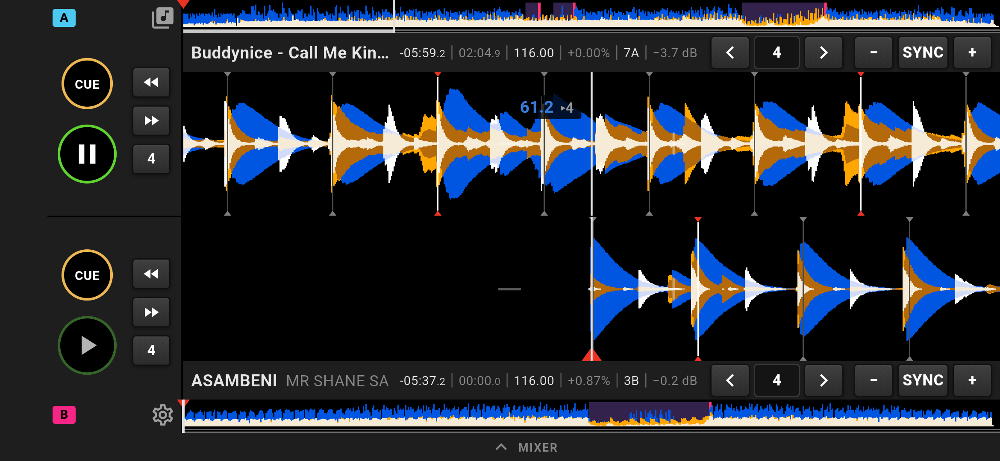
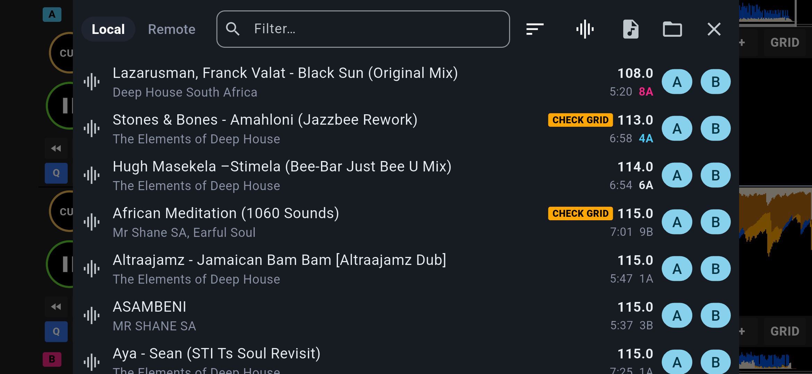

<p align="center">
  
</p>
<h2 align="center"><b>SideDeck</b></h2>
<h4 align="center">Free DJ app for Android and iPhone. Mix on your phone, or on hardware.</h4>

<div align="center">
  <table align="center">
    <tr>
      <td align="center" valign="middle">
        <a href="https://f-droid.org/packages/es.manifold.sidedeck"></a>
      </td>
      <td align="center" valign="middle">
        <a href="https://play.google.com/store/apps/details?id=es.manifold.sidedeck"></a>
      </td>
      <td align="center" valign="middle">
        <a href="https://apps.apple.com/app/id6827595789"></a>
      </td>
    </tr>
  </table>
</div>

Android and iPhone DJ deck for local files and a Subsonic music server.
Landscape dual decks, 3-band waveforms, and an internal mixer, or four-channel
USB out to an external mixer such as the Teenage Engineering EP-136 K.O. Sidekick.

> **This is a fork** of [manueljpy/SideDeck](https://github.com/manueljpy/SideDeck).
> The store badges above install the upstream app, which does not include the
> changes listed under [What this fork adds](#what-this-fork-adds). Build from
> this branch to get them.






## What this fork adds

| Area | Change |
|---|---|
| External mixer | Fixed silent playback on Samsung/Qualcomm phones; decks take the full screen in external mode |
| Waveforms | rbxport-style 3-band waveforms, mirrored at a shared centre line; pinch zoom; smooth motion |
| Deck controls | New control row and transport rail, CUE, hot cues A–D, quantize, beat jump, on-wave nudge |
| Navigation | Drag the waveform to scrub; bar / phrase counter |
| Mixer | Restyled faders with a centre notch and blue offset fill |
| Sync | Beat sync: SYNC matches tempo *and* snaps into beat phase |
| Cues | Cue and hot cues saved per track and restored on load |
| Beat grid | Whole-track analysis, kick-attack grid fit, checked BPM rounding, drift correction, "check grid" warning, hand-fixed grids protected |
| Library | Key display setting (Camelot / musical / both); search filter fix |

Details of each are below.

### External mixer (USB) fix

On some Samsung / Qualcomm phones (found on a Galaxy S26, Android 17, with the
EP-136) external mixer mode turned on but played nothing, and the playhead ran
through the whole track in about a second. The 4-channel track, built in exactly
the mixer format, was matched to a `direct_pcm` output that failed to start
(`AudioTrack: start(): status -32`) after ~10 s of retries; `play()` swallowed
the error and the write loop spun.

- The USB track is now built as float with a channel index mask, which only fits
  the reconfigured mixer thread; the exact mixer format is the fallback.
- A track is only accepted once its playback head actually moves after `play()`.
- The write loop never renders ahead of what the track consumed, and stops
  (instead of spinning) if the output stops taking audio.

Upstream: [issue #13](https://github.com/manueljpy/SideDeck/issues/13),
[PR #14](https://github.com/manueljpy/SideDeck/pull/14).

### Waveforms (after rbxport)

- **3-band colouring:** each column carries low (< 300 Hz), mid (250 Hz–1.2 kHz)
  and high (3–9 kHz) energy, computed in the engine's track scan with
  rekordbox-style envelopes and a per-track gain. Blue = bass / kicks,
  amber = mids / vocals / synths, white = highs / hats; overlaps blend.
- **Mirrored decks:** deck A's detail rises to the line between the decks and
  deck B's hangs from it, so the two beat grids can be compared at a glance.
- **Overview** of the whole track per deck, stacked from its baseline, with a
  played-position bar.
- **Beat grid:** grey beats, white downbeats, triangle heads (red on downbeats).
- **Pinch to zoom** (1.5–32 s across the screen, shared by both decks so their
  grids stay comparable); double-tap resets to 4 s. Far out, only bar lines draw.
- **Smooth motion:** the playhead is animated every frame between engine updates
  instead of hopping 20 times a second.

### Deck controls

- **Control row** between each overview and detail: title and artist, then
  `-MM:SS.t` remaining, `MM:SS.t` elapsed, BPM (0.01), tempo %, key; hot cue pads;
  `½ · LOOP · ×2`; `− · SYNC · +`; `GRID`. Flat rbxport-style buttons that light blue.
- **Transport rail:** CUE, PLAY, beat-jump ◀◀ ▶▶, **Q** (quantize) and the jump
  size; small A/B tags; library (deck A) and settings (deck B).
- **On-wave nudge:** faint − / + either side of the playhead. Hold while playing
  to bend tempo ±8 %; tap or hold while paused to jog 40 ms.
- **Bar / phrase counter** beside the playhead, e.g. `33.2 ▸3`: bar 33, beat 2,
  three bars to the next 8-bar phrase (red on the last bar). Bar 1 is the grid's
  first beat.

### Cues, hot cues and scrubbing

- **Drag the detail waveform** to move the track under the playhead like a
  record (playing or paused); drag or tap the overview to seek.
- **CUE** works like a CDJ: paused, it sets the cue at the playhead; playing, it
  returns to the cue and pauses; held on the cue point, it previews and snaps
  back on release (press PLAY while holding to keep playing).
- **Hot cues A–D:** tap an empty pad to store the playhead, tap a set pad to jump
  (staying playing or paused), long-press to clear. Badges mark them on the
  waveform and overview.
- **Saved per track:** the cue and hot cues are stored by file path and restored
  on load; a deck with a saved cue opens parked on it.
- **Quantize (Q, on by default):** CUE, new hot cues and loop-in snap to the
  nearest beat, and hot cue jumps while playing keep the beat phase.
- **Beat jump:** ◀◀ ▶▶ by 1, 2, 4, 8, 16 or 32 beats (tap the size box to cycle).

### Mixer

Restyled after rbxport's neutral mixer: flat faders on thin rails with a centre
notch, and a blue fill from the centre so any EQ, filter or crossfader move away
from flat is visible. In external mixer mode the strip is hidden and the decks
use the whole screen.

### Sync

SYNC matches the synced deck's tempo to the other deck and keeps following it.
With both decks playing it also shifts the synced deck by under half a beat so
the beats line up; a synced deck started under a playing deck snaps into phase
as it starts. It aligns beats, not bars.

### Beat grid accuracy

Studied from [Mixxx](https://github.com/mixxxdj/mixxx),
[rbxport](https://github.com/chrisle/rbxport) and
[openDJ](https://github.com/openwave-studio/opendj):

- **Whole-track analysis** (up to 15 min) instead of the first 60 s, decoded in
  chunks so memory stays around 4 bytes per sample.
- **Kick-attack fit** (rbxport): each predicted beat is snapped to the kick's
  attack, found to the millisecond in the 900–9000 Hz click band, and a weighted
  line through the hits gives the period and phase. It is only used where it
  clearly locks on (≥ 45 % of beats on an attack, median ≤ 2 ms); soft, round
  kicks keep the low-band grid.
- **Checked rounding:** a whole BPM is kept only if its grid still sits on the
  hits (rbxport's 85 % rule), so a real 127.97 track is not rounded into drift.
- **Drift correction:** for soft kicks the grid's offset is followed through
  the track in 16-bar windows of low-band kick energy; a steady drift corrects
  the BPM, kept only if the grid then holds clearly better.
- **"Check grid" warning:** if the grid does not hold through the track (a
  wrong tempo, a tempo change, or a section stitched in at a different phase),
  the deck's BPM turns amber with a "!" and the library shows **CHECK GRID**.
  A tight kick-attack lock counts as trusted.
- **Hand-fixed grids are protected:** grid edits mark a track, "Re-analyze all"
  skips it, and the analysis cache now migrates in place instead of being wiped
  on upgrades. Re-analyzing a single track still replaces the fix on purpose.

Grids analyzed by an older build keep their old values until re-analyzed
("Re-analyze all" in the library).

### Library and settings

- **Key display** (Settings): Camelot `10A` (default), musical `Bm`, or both.
- **Search fix:** the filter could stay active after a search while the box
  looked empty, so other tracks could not be picked. The box now shows the
  active filter and has a clear button.

## Controls quick reference

| Control | Where | What it does |
|---|---|---|
| Drag waveform | Detail | Scrub through the track |
| Pinch / double-tap | Detail | Zoom / reset zoom |
| − / + | Beside the playhead | Hold to nudge tempo (playing), jog (paused) |
| Tap / drag | Overview | Seek |
| CUE | Rail | Set / return / preview (CDJ style) |
| ◀◀ ▶▶ and size box | Rail | Beat jump; tap the box for 1–32 beats |
| Q | Rail | Quantize on / off |
| A B C D | Control row | Hot cues: tap set or jump, long-press clear |
| ½ · LOOP · ×2 | Control row | Halve, toggle, double the loop |
| − · SYNC · + | Control row | BPM ±0.1, beat sync |
| GRID | Control row | Shift the grid by a beat or 5 ms |

## Requirements

- Flutter stable (SDK ^3.12) - see [install Flutter](https://docs.flutter.dev/get-started/install)
- Android: NDK (ships with Flutter / Android Studio); Android 8.0+ (API 26), arm64 recommended
- iPhone: macOS with Xcode 15+, CMake 3.22+ (`brew install cmake`); iOS 15+
- USB host / USB-C (or a Lightning camera adapter) if you use an external mixer

## Build

```bash
flutter pub get
flutter run -d <android-or-ios-device>
```

Debug APK:

```bash
flutter build apk --debug
```

Output: `build/app/outputs/flutter-apk/app-debug.apk`

Newer Flutter releases may want a newer Gradle than this project pins; add
`--android-skip-build-dependency-validation` to build anyway. On a machine with
little free memory, `--target-platform android-arm64` and a smaller Gradle heap
(`org.gradle.jvmargs` in `android/gradle.properties`) help.

iOS (macOS + Xcode + CMake):

```bash
flutter build ios --debug --no-codesign
```

Or open `ios/Runner.xcworkspace` in Xcode, pick your iPhone, and Run. The C++
engine is compiled by CMake during the Xcode build.

## What works today

- Dual-deck landscape UI with 3-band waveforms (no platters)
- Native engine (Oboe on Android, Core Audio on iOS), MP3 / WAV / FLAC / Opus / Ogg Vorbis / AAC (M4A); ALAC when the device has a decoder
- Internal mixer: 3-band EQ, filter, crossfader
- BPM / key analysis on load (cached in SQLite); Camelot or musical key labels
- Beat detector: Queen Mary TempoTrackV2 + Mixxx BeatUtils, refined on kick attacks and checked for drift; key: Queen Mary GetKeyMode
- Beat sync, loops (½ / ×2), BPM ±0.1, nudge, quantize, beat jump
- CUE and hot cues A–D, saved per track; waveform scrubbing; pinch zoom
- GRID edits the beatgrid (1 beat or 5 ms); "check grid" warning
- Local folder/file picker; sort; analyze missing or all (iPhone: Files app / Finder sharing)
- Library highlights keys compatible with a loaded deck
- Subsonic browse and cache-to-file
- External USB mixer: Deck A → channels 1–2, Deck B → channels 3–4

Keylock (pitch-held tempo) is on by default.

## External mixer

Turn on **Use external mixer** in Settings with a USB mixer plugged in. Deck A
goes out on channels 1–2 and Deck B on channels 3–4 so you mix and cue on the
hardware. The on-screen EQ and crossfader hide in this mode and the decks take
the whole screen; the connected device is shown in Settings.

Works with USB mixers that take two stereo decks this way, including the
Teenage Engineering EP-136 K.O. Sidekick (set USB mode to **Multi**, not
Controller). On iPhone, use USB-C or a Lightning camera adapter; the mixer
must be class-compliant USB audio.

## Subsonic

[Subsonic](http://www.subsonic.org/pages/api.jsp) is an API for a music
library you host yourself. Servers such as [Navidrome](https://www.navidrome.org/)
speak it. In Settings you can point SideDeck at that server, browse albums
and tracks, and download them to the phone to mix like local files.

## Flutter

SideDeck is a Flutter application (Dart UI + FFI into C++). Docs:
[flutter.dev](https://docs.flutter.dev/).

## Project layout

```
lib/                 Dart UI, controllers, Subsonic client, FFI
native/engine/       C++ engine, EQ, analysis, iOS Core Audio
android/app/         Android host, USB AudioTrack output
ios/                 iPhone host, CMake engine build
third_party/         Oboe, Signalsmith, qm-dsp, dr_libs, ogg/opus/opusfile/vorbis
test/                Dart tests
```

## Credits

The waveform, deck and mixer design and the kick-attack grid fit are adapted
from [rbxport](https://github.com/chrisle/rbxport) (GPL-2.0-or-later). The grid
work also draws on [Mixxx](https://github.com/mixxxdj/mixxx) and
[openDJ](https://github.com/openwave-studio/opendj) (both GPL-2.0-or-later).

## License

SideDeck is free software under the [GNU GPL v3 or later](LICENSE).
Third-party licenses are listed in [NOTICE](NOTICE) and
[third_party/README.md](third_party/README.md).
